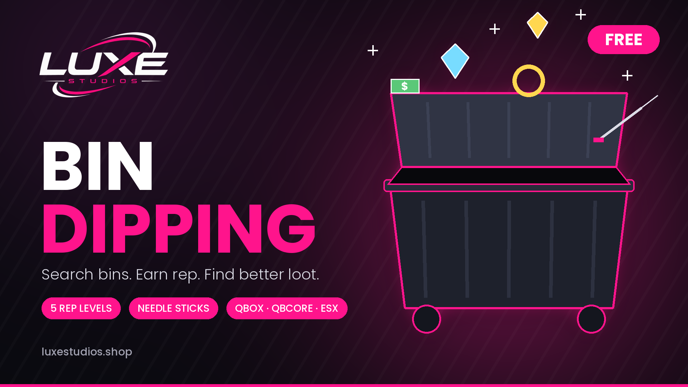

<p align="center">
  
</p>

# Luxe Bin Dipping

Free bin dipping script for FiveM with a **reputation system**. Search bins, level up, find better loot, and watch out for dirty needles. Supports **Qbox, QBCore, ESX and TMC**, detected automatically.

**By [Luxe Studios](https://luxestudios.shop)** · Free & open source (GPL-3.0)

---

## Features
- 🗑️ **Search any bin or dumpster** with the third eye: skill check, rummage animation, progress bar
- ⭐ **5 rep levels**, from *Rookie Rummager* to *Garbage God*. More rep means more loot rolls, fewer empty bins and rarer finds.
- 💎 **5 loot tiers**: junk, common, uncommon, rare and legendary
- 💉 **Dirty needle sticks** (20% by default): damage, trippy screen, camera shake, drunk walk, no sprinting for 3 minutes. Everything is configurable.
- 📊 **Reputation menu** on the radial menu (`luxe_reputation`) and `/binrep`
- 🔒 **Server-side loot and rep** with distance, timing and cooldown checks
- 🔌 **Multi-framework**: Qbox / QBCore / ESX, ox_inventory / qb-inventory / ESX inventory, ox_target / qb-target
- 🌍 **Translatable** via ox_lib locales
- ⚡ **0.00ms idle**

## What's in this repo
| Folder | What it is |
|---|---|
| [`luxe_bindipping`](luxe_bindipping) | The bin dipping script (**required**) |
| [`luxe_reputation`](luxe_reputation) | Reputation button on the radial menu + `/rep` (**optional**, but recommended) |

## Quick install
1. [Download the latest release](../../releases/latest) (or clone this repo).
2. Put `luxe_bindipping` and `luxe_reputation` in your `resources` folder (for example inside a `[luxe]` folder).
3. Add to your `server.cfg`, **after** your framework, inventory, target and `ox_lib`:
   ```
   ensure luxe_bindipping
   ensure luxe_reputation
   ```
4. ESX with the default inventory: run `luxe_bindipping/install/esx_items.sql`.
5. ox_inventory users: disable the default "Search Dumpster" option ([see the full guide](luxe_bindipping/README.md#installation)).
6. Restart your server.

**Requirements:** [`ox_lib`](https://github.com/overextended/ox_lib), plus a supported framework, inventory and target system.

📖 **Full documentation, every config option and troubleshooting:** [`luxe_bindipping/README.md`](luxe_bindipping/README.md)

## Commands
| Command | Who | Description |
|---|---|---|
| `/binrep` | Everyone | Your bin dipping level and progress |
| `/rep` | Everyone | All your reputation (needs `luxe_reputation`) |
| `/setbinrep [id] [amount]` | Admin | Set a player's rep |
| `/clearneedle [id]` | Admin | Remove needle stick effects |

## Support
Found a bug or have an idea? [Open an issue](../../issues). Pull requests (including translations) are welcome.

## License
[GNU GPL v3](LICENSE): free to use, modify and share. Modified versions must stay open source, and it may **not be sold or escrowed**. Please keep the credit to **Luxe Studios**.
